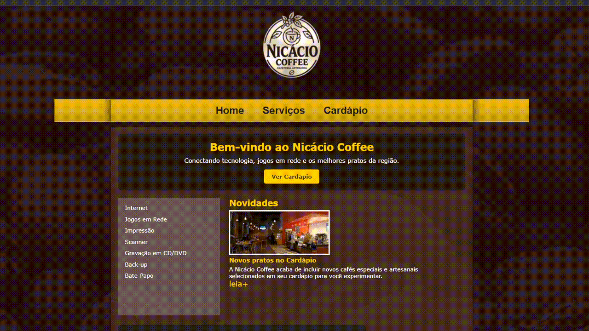

# ☕ Site Nicácio Coffee

## 💡 Sobre o Projeto
Projeto desenvolvido como parte do desafio prático de **Desenvolvimento Web com HTML e CSS**, com o objetivo de estruturar páginas utilizando **HTML semântico** (`<header>`, `<nav>`, `<main>`, `<section>`), organizar elementos com **Flexbox** e aplicar estilização com **CSS puro**, sem utilização de frameworks. O site simula a página de uma cafeteria fictícia, apresentando cardápio, serviços e um canal de atendimento e contato.

## 📸 Demonstração


## 🛠️ Tecnologias Utilizadas
- HTML5 / CSS3 / JavaScript
- Git e GitHub / GitHub Pages

## 🚀 Como Rodar o Projeto Localmente
Para executares este projeto na tua máquina, segue os passos abaixo:

1. Clona este repositório:
   ```bash
   git clone https://github.com/Anarricchima/site-vitrine-cin-tica.git